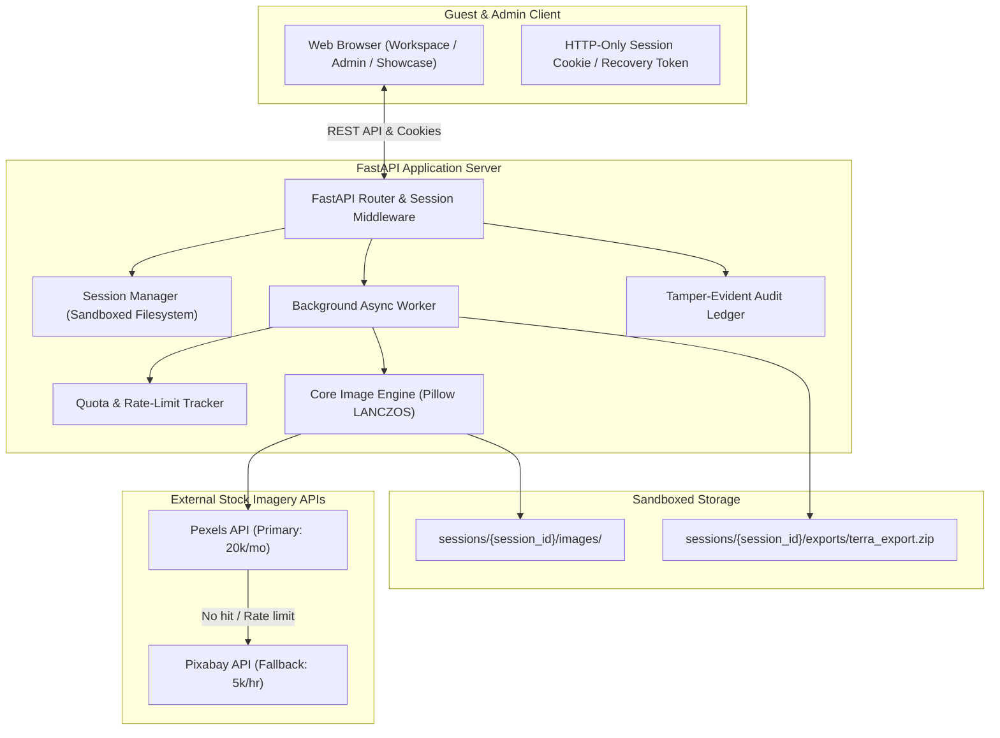

# 🌍 Terra Image Studio • Universal Multipurpose Image Engine

[](https://www.python.org/)
[](https://fastapi.tiangolo.com/)
[](https://www.uvicorn.org/)
[](https://www.docker.com/)
[](https://opensource.org/licenses/MIT)

> **A high-performance batch image pipeline and web studio built with FastAPI.** Transform any list—places, products, editorial blog titles, social posts, or keywords—into focal-cropped, high-resolution **WebP**, **PNG**, or **JPG** assets. Includes automated provider fallbacks, zero-registration isolated guest sandboxes, interactive image review, ZIP packaging with source credits, and a privacy-sealed **Admin Console**.

---

## 📑 Table of Contents

- [Architectural Highlights](#-architectural-highlights)
- [System Architecture](#-system-architecture)
- [Crop & Aspect Ratio Presets](#-crop--aspect-ratio-presets)
- [Guest Sessions & Privacy Model](#-guest-sessions--privacy-model)
- [Admin Console & Governance](#-admin-console--governance)
- [Quick Start](#-quick-start)
- [Production Deployment](#-production-deployment)
  - [Option A: Docker & Docker Compose](#option-a-docker--docker-compose-recommended)
  - [Option B: Systemd Service (Linux VPS)](#option-b-systemd-service-linux-vps)
  - [Option C: Nginx Reverse Proxy](#option-c-nginx-reverse-proxy)
  - [Option D: Cloud PaaS (Railway / Render / Fly.io)](#option-d-cloud-paas-railway--render--flyio)
- [Environment Variables](#-environment-variables)
- [REST API Reference](#-rest-api-reference)
- [Standalone CLI Downloader](#-standalone-cli-downloader)
- [Security & Compliance](#-security--compliance)
- [License](#-license)

---

## ⚡ Architectural Highlights

- **Universal Multipurpose Scope:** Process any subject matter (e-commerce products, travel landmarks, technology, fashion, automotive, blog post titles).
- **Intelligent Focal Center-Crop:** Center-crops and resizes using Pillow (`LANCZOS` filter) to eliminate black bars, stretching, and distortion.
- **Smart Fallback Pipeline:** Automatically queries **Pexels** first; if rate-limited or unavailable, seamlessly fails over to **Pixabay**. Includes duplicate detection.
- **Interactive Review:** Inspect assets in a visual grid, swap alternative search candidates without re-downloading, retry failed items, or delete entries.
- **Automated Licensing Credits:** Exports a single ZIP containing all ready images and a structured `credits.txt` documenting photographer names, profile links, and commercial licenses.
- **Zero-Registration Guest Sandboxes:** Each visitor receives an isolated browser-scoped workspace. No login required.
- **Cross-Device Unguessable Recovery Link:** Resume in-progress workspaces on another browser or phone via cryptographic tokens.
- **Automated Self-Destruct:** Sessions auto-expire after 24 hours (configurable) with background worker cleanup, plus an instant *"Delete my data"* self-destruct button.
- **Privacy-Sealed Admin Console:** Passkey-protected dashboard with live quota meters, connection latency testing, provider priority ordering, and queue monitoring. **Admin never sees guest keywords or images.**
- **Editorial UI Design:** Typography with Bricolage Grotesque, DM Sans, IBM Plex Mono, light/dark mode palettes, and 3D volume charts.

---

## 🏗️ System Architecture



---

## 📐 Crop & Aspect Ratio Presets

| Preset Name | Aspect Ratio | Dimensions | Resampling | Best For |
|---|:---:|:---:|:---:|---|
| **Travel and places** | `16:9` | `1920 x 1080 px` | `LANCZOS` | Landscape hero banners, travel guides, desktop wallpapers |
| **Products & catalogs**| `1:1` | `1080 x 1080 px` | `LANCZOS` | E-commerce listings, catalog cards, square thumbnails |
| **Editorial & blog**   | `3:2` | `1200 x 800 px`  | `LANCZOS` | Blog headers, magazine features, photo essays |
| **Social posts**       | `4:5` | `1080 x 1350 px` | `LANCZOS` | Instagram feed, Pinterest pins, mobile story cards |

*Custom resolution width (640px to 1920px) and compression quality (40 to 100) are fully adjustable in the workspace settings.*

---

## 🔒 Guest Sessions & Privacy Model

1. **Pure Browser Sandbox:**
   Upon visiting the studio, the server generates a random session identifier (e.g. `s_8075da54`). All images, metadata, and generated ZIP files are isolated in `sessions/{session_id}/`. A guest cannot view or access another guest's data.
2. **Cross-Device Recovery Link:**
   Selecting **Guest session** > **Copy recovery link** generates an unguessable URL:
   ```
   https://your-domain.com/?recovery=rec_a6ba9f08e4...
   ```
   Opening this link on any device restores the exact in-progress session.
3. **24-Hour Self-Destruct:**
   Sessions expire automatically 24 hours after creation. A background cleaner deletes expired folders every 10 minutes. Guests can also click **Extend by 24 hours** at any time.
4. **Immediate Self-Wipe ("Delete my data"):**
   Clicking **Delete my data** triggers an atomic deletion of all images, lists, and archives from disk.

---

## 🛡️ Admin Console & Governance

Access the Admin Console via the **Admin** tab in the top navigation bar.

- **Default Passkey:** `admin123` *(configurable via `ADMIN_PASSKEY` environment variable or `admin_config.json`)*.
- **Provider Key Governance:**
  - Encrypted/masked key inputs with Show/Hide toggle.
  - Live connection latency test (checks ping time, validity, and HTTP response headers).
  - Primary / Fallback priority reordering (move Pexels or Pixabay up/down).
- **Quota Tracking Meters:**
  - Pexels: Real-time meters for 200 requests/hour and 20,000 requests/month.
  - Pixabay: Real-time meters for 5,000 requests/hour.
- **Strict Privacy Seal:**
  - The Admin queue monitor displays **only Job IDs, masked sessions (`s_b208...44e`), item counts, provider badges, and timestamps**.
  - **Admin accounts never see guest search keywords, place names, or image thumbnails.**
- **Storage Purge:**
  - One-click maintenance button to purge all expired sessions and reclaim storage.

---

## 🚀 Quick Start

### Prerequisites
- Python 3.10, 3.11, or 3.12
- Free API keys from [Pexels](https://www.pexels.com/api/) and/or [Pixabay](https://pixabay.com/api/docs/)

### 1. Clone & Setup
```bash
git clone https://github.com/pankaj12mayank/Image-Scripts.git
cd Image-Scripts
```

### 2. Configure Credentials
```bash
# On Windows:
copy .env.example .env

# On Linux/macOS:
cp .env.example .env
```
Edit `.env` with your API credentials:
```env
PEXELS_API_KEY=your_pexels_key_here
PIXABAY_API_KEY=your_pixabay_key_here
ADMIN_PASSKEY=your_secure_admin_passkey
```

### 3. Launch with One Command

**Windows Command Prompt:**
```cmd
start.cmd
```

**Windows PowerShell:**
```powershell
.\start.ps1
```

**Linux / macOS / Python:**
```bash
python run.py
```

The studio will start on **`http://localhost:8000`** and open automatically in your browser. API documentation is available at **`http://localhost:8000/docs`**.

---

## 🚢 Production Deployment

### Option A: Docker & Docker Compose (Recommended)

Run the entire studio in an isolated container with persistent volumes:

```bash
# 1. Start container
docker compose up -d --build

# 2. View container logs
docker compose logs -f

# 3. Stop container
docker compose down
```

The `docker-compose.yml` mounts `./sessions` and `./providers_config.json` to preserve credentials and guest state across container rebuilds.

---

### Option B: Systemd Service (Linux VPS)

To run Terra Studio as a background daemon on an Ubuntu/Debian server:

1. Create a service unit file:
   ```bash
   sudo nano /etc/systemd/system/terra-studio.service
   ```
2. Paste the following configuration:
   ```ini
   [Unit]
   Description=Terra Image Studio FastAPI Service
   After=network.target

   [Service]
   User=www-data
   Group=www-data
   WorkingDirectory=/var/www/Image-Scripts
   EnvironmentFile=/var/www/Image-Scripts/.env
   ExecStart=/usr/bin/python3 -m uvicorn server:app --host 127.0.0.1 --port 8000 --workers 4
   Restart=always
   RestartSec=5

   [Install]
   WantedBy=multi-user.target
   ```
3. Enable and start the service:
   ```bash
   sudo systemctl daemon-reload
   sudo systemctl enable terra-studio
   sudo systemctl start terra-studio
   ```

---

### Option C: Nginx Reverse Proxy

Configure Nginx with SSL termination, compression, and WebSocket support:

```nginx
server {
    listen 80;
    server_name images.yourdomain.com;
    return 301 https://$host$request_uri;
}

server {
    listen 443 ssl http2;
    server_name images.yourdomain.com;

    ssl_certificate /etc/letsencrypt/live/images.yourdomain.com/fullchain.pem;
    ssl_certificate_key /etc/letsencrypt/live/images.yourdomain.com/privkey.pem;

    client_max_body_size 50M;

    location / {
        proxy_pass http://127.0.0.1:8000;
        proxy_set_header Host $host;
        proxy_set_header X-Real-IP $remote_addr;
        proxy_set_header X-Forwarded-For $proxy_add_x_forwarded_for;
        proxy_set_header X-Forwarded-Proto $scheme;

        # WebSocket support
        proxy_http_version 1.1;
        proxy_set_header Upgrade $http_upgrade;
        proxy_set_header Connection "upgrade";
    }
}
```

---

### Option D: Cloud PaaS (Railway / Render / Fly.io)

For cloud container platforms:
- **Build Command:** `pip install -r requirements.txt`
- **Start Command:** `uvicorn server:app --host 0.0.0.0 --port ${PORT:-8000}`
- **Environment Variables:** Set `PEXELS_API_KEY`, `PIXABAY_API_KEY`, and `ADMIN_PASSKEY` in your provider dashboard.

---

## ⚙️ Environment Variables

| Variable | Required | Default | Description |
|---|:---:|:---:|---|
| `PEXELS_API_KEY` | Recommended | `""` | Primary image provider key ([Pexels API](https://www.pexels.com/api/)) |
| `PIXABAY_API_KEY` | Recommended | `""` | Fallback image provider key ([Pixabay API](https://pixabay.com/api/docs/)) |
| `ADMIN_PASSKEY` | Optional | `admin123` | Security key required to access the Admin Console |
| `PORT` | Optional | `8000` | Port for the HTTP server |
| `CONCURRENT_REQUESTS` | Optional | `5` | Maximum simultaneous worker downloads |
| `RETRY_LIMIT` | Optional | `2` | Automatic retry attempts on network error |

---

## 📡 REST API Reference

### Guest Workspace Endpoints
| Method | Endpoint | Description |
|---|---|---|
| `GET` | `/` | Serves the unified web studio UI |
| `GET` | `/api/session` | Resolves or initializes guest session state & items |
| `POST` | `/api/session/settings` | Updates preset (`travel`, `products`, `blog`, `social`), format (`WEBP`, `PNG`, `JPG`), width, and quality |
| `POST` | `/api/session/items` | Replaces session list (supports CSV or multiline paste) |
| `POST` | `/api/session/item/add` | Adds a single entry (`c`: category, `p`: place/keyword) |
| `DELETE` | `/api/session/item/{id}` | Removes a specific item and deletes its file |
| `DELETE` | `/api/session/items` | Clears all items in the current session |
| `POST` | `/api/session/extend` | Extends session expiration by 24 hours |
| `POST` | `/api/session/delete` | Immediate self-destruct of all session files and archives |
| `POST` | `/api/session/job/start` | Dispatches background batch download & crop pipeline |
| `GET` | `/api/session/job/status` | Polls progress bar percentage, counters, and live items |
| `POST` | `/api/session/item/swap` | Swaps an item with an alternative candidate without re-downloading |
| `POST` | `/api/session/item/retry` | Re-queries and processes a failed item |
| `GET` | `/api/session/export-zip` | Downloads packaged `.zip` with all images and `credits.txt` |
| `GET` | `/api/session/export-credits` | Directly downloads `credits.txt` |
| `GET` | `/api/session/image/{sid}/{file}` | Securely streams a processed image file |

### Admin Console Endpoints (Strict Privacy Rules)
| Method | Endpoint | Description |
|---|---|---|
| `POST` | `/api/admin/login` | Authenticates passkey and issues admin authorization token |
| `GET` | `/api/admin/overview` | Returns aggregate statistics, sparklines, and quota meters |
| `GET` | `/api/admin/providers` | Retrieves list of providers with masked credentials |
| `POST` | `/api/admin/providers` | Updates provider keys, enabled states, and priority weights |
| `POST` | `/api/admin/providers/order` | Sets primary/fallback provider ordering |
| `POST` | `/api/admin/providers/test` | Performs live connection ping to test key validity and latency |
| `GET` | `/api/admin/policy` | Retrieves guest TTL and rate limits |
| `POST` | `/api/admin/policy` | Updates guest TTL, row limits, and processing defaults |
| `GET` | `/api/admin/queue` | Returns privacy-sealed queue monitor (anonymized metrics only) |
| `POST` | `/api/admin/purge` | Purges expired guest sessions and reclaims storage |
| `GET` | `/api/admin/audit` | Retrieves tamper-evident system audit log |

---

## 💻 Standalone CLI Downloader

For automated headless pipelines or cron jobs, the original country downloader is fully functional:

```bash
# Run full download pipeline for 194 world destinations:
python image_downloader.py

# Audit destination status without downloading (Dry Run):
python image_downloader.py --dry-run

# Limit parallel downloads:
python image_downloader.py --concurrency 5
```

---

## 🛡️ Security & Compliance

- **No Data Retention by Default:** Guest data automatically self-destructs after 24 hours.
- **Path Traversal Protection:** Image file requests are validated against absolute directory paths to prevent directory traversal attacks.
- **Filename Sanitization:** All filenames are stripped of non-alphanumeric characters, quotes, and directory separators.
- **Anonymized Telemetry:** The Admin Console is mathematically isolated from guest search queries and images.

---

## 📄 License

Distributed under the **MIT License**. See `LICENSE` for details.
All imagery sourced via the engine remains subject to [Pexels License](https://www.pexels.com/license/) and [Pixabay License](https://pixabay.com/service/license/).
